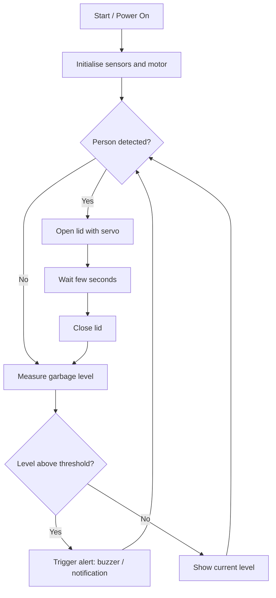

# ♻️ Smart Dustbin: Final Year Project
 
> An intelligent waste-bin system that [detects fill level / opens automatically / alerts when full / sorts waste: **keep only what your project does**] to make waste collection cleaner, faster and more efficient.
 

 
---
 
## 📌 Table of Contents
1. [Overview](#-overview)
2. [The Problem](#-the-problem)
3. [Project Goals](#-project-goals)
4. [The Solution](#-the-solution)
5. [How It Works](#-how-it-works)
6. [System Architecture](#-system-architecture)
7. [Tech Stack](#-tech-stack)
8. [Hardware Components](#-hardware-components)
9. [Project Structure](#-project-structure)
10. [Installation and Setup](#-installation-and-setup)
11. [Usage](#-usage)
12. [Results](#-results)
13. [Limitations and Future Work](#-limitations-and-future-work)
14. [Author](#-author)
---
 
## 🔍 Overview
 
This is my final year project: a **Smart Dustbin** that replaces the traditional "dumb" bin with an automated, sensor-driven one. It [one-sentence summary of what it does, e.g. senses when someone approaches and opens its lid hands-free, monitors how full it is, and sends an alert when it needs emptying].
 
---
 
## ❗ The Problem
 
Traditional dustbins have several everyday issues:
 
- **Overflowing bins**: nobody knows a bin is full until garbage is already spilling out, causing bad smell, pests and disease.
- **Inefficient collection**: collection vehicles follow fixed routes, visiting bins that are half-empty while others overflow.
- **Hygiene concerns**: people must touch the lid to open it, spreading germs.
- **No data**: authorities have no information about how fast bins fill up in different areas.
*(Edit this list to match the problems **your** project targets.)*
 
---
 
## 🎯 Project Goals
 
1. Build a low-cost bin that works **without physical contact**.
2. **Monitor the fill level** in real time.
3. **Notify** the responsible person when the bin is nearly full.
4. Reduce unnecessary collection trips and keep surroundings clean.
5. Keep the design simple, affordable and easy to replicate.
---
 
## 💡 The Solution
 
I built a smart dustbin using a **microcontroller** connected to **sensors and actuators**. Sensors detect a person approaching and measure the garbage level; the microcontroller processes the readings and drives a motor to open the lid, then [sends data to a display / mobile app / cloud dashboard / SMS].
 
---
 
## ⚙️ How It Works
 
Step-by-step working of the complete system:
 
1. **Power on**: the microcontroller initialises all sensors, the servo motor and [display/communication module].
2. **Detection**: a [ultrasonic / IR / PIR] sensor at the front continuously checks for a person or object within a set distance (e.g. 30 cm).
3. **Lid opens**: when someone is detected, the microcontroller commands the **servo motor** to rotate and lift the lid.
4. **Lid closes**: after a short delay, or when the person moves away, the lid closes automatically.
5. **Fill-level measurement**: a second sensor inside the bin measures the distance to the garbage surface. The shorter the distance, the fuller the bin.
6. **Level calculation**: the distance is converted to a percentage:
```
   fill % = ((bin_height − measured_distance) / bin_height) × 100
```
7. **Alert / display**: the level is shown on [LCD / app / dashboard]. When it crosses a threshold (e.g. 80%), a [buzzer / LED / notification / SMS] is triggered.
8. **Repeat**: the loop runs continuously.
### Flowchart
 

 
---
 
## 🏗️ System Architecture
 
```
 ┌────────────┐      ┌────────────────┐      ┌──────────────────┐
 │  Sensors   │ ───► │ Microcontroller│ ───► │  Outputs         │
 │ (Distance, │      │ (Arduino/ESP)  │      │ Servo, Buzzer,   │
 │  Level)    │      │ Processing     │      │ LCD, App/Cloud   │
 └────────────┘      └────────────────┘      └──────────────────┘
```
 
| Layer | Role |
|-------|------|
| **Input layer** | Sensors that collect real-world data (presence, fill level) |
| **Processing layer** | Microcontroller running the control logic |
| **Output layer** | Servo motor, buzzer, display and/or wireless notification |
 
---
 
## 🧰 Tech Stack
 
### Hardware
| Component | Purpose |
|-----------|---------|
| [Arduino Uno / NodeMCU ESP8266 / ESP32] | Brain of the system; reads sensors and controls outputs |
| [HC-SR04 Ultrasonic sensor] (×2) | Detects approaching person and measures garbage level |
| [SG90 Servo motor] | Opens and closes the lid |
| [Buzzer / LED] | Local alert when the bin is full |
| [16×2 LCD (I2C)] | Displays fill level |
| [Wi-Fi / GSM module] | Sends data or alerts remotely |
| Power supply / battery | Powers the circuit |
 
### Software
| Tool | Purpose |
|------|---------|
| [Arduino IDE] | Writing and uploading firmware |
| [C / C++ (Arduino)] | Programming language for the microcontroller |
| [Blynk / Firebase / ThingSpeak / MQTT] | Cloud / IoT platform for monitoring (if used) |
| [Libraries: Servo.h, NewPing.h, LiquidCrystal_I2C.h] | Hardware drivers |
 
> ✏️ **Replace every `[bracketed]` item with what you actually used and delete the rows that don't apply.**
 
---
 
## 🔌 Hardware Components
 
Include your **circuit diagram** and a **pin connection table**:
 
| Component | Pin on board |
|-----------|--------------|
| Ultrasonic 1 (Trig / Echo) | D2 / D3 |
| Ultrasonic 2 (Trig / Echo) | D4 / D5 |
| Servo signal | D9 |
| Buzzer | D8 |
| LCD (SDA / SCL) | A4 / A5 |
 

 
---
 
## 📁 Project Structure
 
```
final-year-project-final-draft/
├── samrt dustbntaKE2/      # Main project folder (source code / files)
│   ├── [main code file]
│   └── [other files]
├── docs/
│   └── images/             # Screenshots, circuit diagram, prototype photos
├── .gitignore
└── README.md
```
 
---
 
## 🚀 Installation and Setup
 
### Prerequisites
- [Arduino IDE](https://www.arduino.cc/en/software) installed
- Required libraries: `[list them]`
- All hardware connected as per the circuit diagram
### Steps
```bash
# 1. Clone the repository
git clone https://github.com/Abin-ms/final-year-project-final-draft.git
 
# 2. Open the project folder
cd final-year-project-final-draft
```
3. Open the main `.ino` file from the project folder in Arduino IDE.
4. Install the required libraries via **Sketch → Include Library → Manage Libraries**.
5. Select your board and COM port under **Tools**.
6. Click **Upload**.
7. [If using Wi-Fi/cloud: add your Wi-Fi name, password and API key in the config section of the code.]
---
 
## ▶️ Usage
 
1. Power the device.
2. Move your hand or an object in front of the bin: the lid opens.
3. Drop waste in; the lid closes automatically.
4. Check the fill level on the [display / app].
5. When the level crosses the limit, the alert is triggered and the bin should be emptied.
---
 
## 📊 Results
 
- Detection range: **[x] cm**
- Lid response time: **[x] seconds**
- Level measurement accuracy: **[x]%**
- Tested under: [conditions]

 
---
 
## 🔭 Limitations and Future Work
 
**Current limitations**
- [e.g. Ultrasonic sensors can give wrong readings with uneven garbage surfaces]
- [e.g. Needs a stable Wi-Fi connection / power supply]
**Future improvements**
- Solar-powered operation
- Waste segregation (wet / dry / metal) using AI or extra sensors
- GPS tracking and route optimisation for collection vehicles
- Mobile app and analytics dashboard for municipalities
- Gas sensor for odour/hazard detection
---
 
## 👤 Author
 
**Abin M S**
- GitHub: [@Abin-ms](https://github.com/Abin-ms)
- [LinkedIn / Email]
- [College name, Department, Year]
---
 
⭐ If you found this project useful, please consider giving it a star!
 